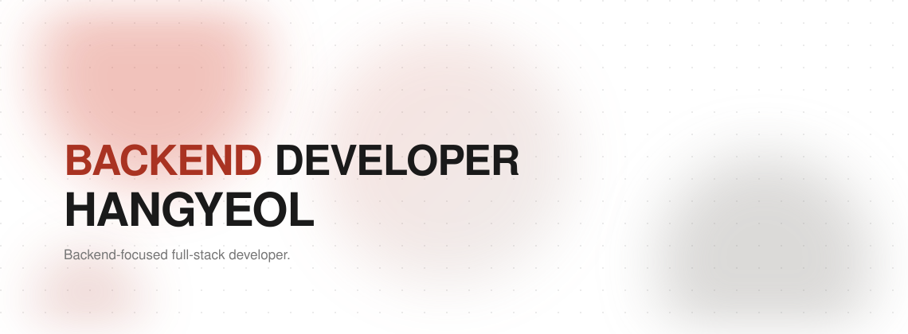
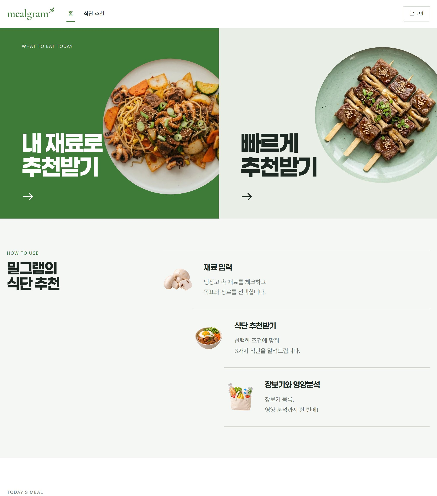
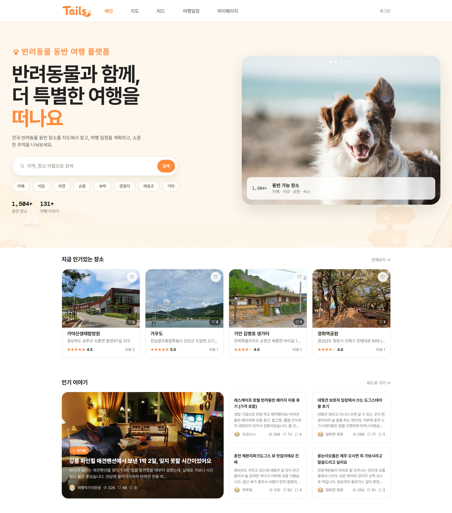

<picture>
  <source media="(prefers-color-scheme: dark)" srcset="https://raw.githubusercontent.com/1gyeolpark/1gyeolpark/output/github-contribution-grid-snake-dark.svg">
  <source media="(prefers-color-scheme: light)" srcset="https://raw.githubusercontent.com/1gyeolpark/1gyeolpark/output/github-contribution-grid-snake.svg">
  
</picture>

  

 

 $\scriptsize\textsf{\color{#8e8a85}{▲ 클릭 바로가기}}$

  
## Tech Stack

| **Backend** |      |
|:---:|:---|
| **Frontend** |       |
| **Infra/DevOps** |       |
| **Studying** |        |

  

## Projects

<table width="90%">
<tr>
<td width="260" align="center">

</td>
<td>

### mealgram 
> <small>신체 정보와 내 재료로 영양 기준에 맞는 식단을 추천해 주는 사이트</small>

      

- 규칙 기반 요리 조합 식단 추천, 한국인 영양소 섭취기준 검증
- OpenAI 식단 후보 선택과 이름 작성, 실패 시 규칙 후보로 대체
- JWT Access/Refresh 토큰 인증, 이메일 인증번호 회원가입
- Redis 기반 인증번호와 호출 제한 관리
- 장보기 목록 계산, 내 식단 저장

 
</td>
</tr>
</table>

 

<table width="90%">
<tr>
<td width="260" align="center">

</td>
<td>

### Tails 
> <small>반려동물과 여행할 수 있는 장소를 검색하고, 여행 일정을 계획하는 서비스</small>

      

- JWT Access/Refresh 토큰 인증
- 카카오, 구글, 네이버 OAuth2 소셜 로그인
- 게시판 CRUD, 좋아요와 북마크, 무한 depth 대댓글
- 반려동물 등록 CRUD
- 이벤트 기반 알림 + FCM 웹 푸시

 
</td>
</tr>
</table>

 

 

## Study

> <small>학습 내용을 주제별로 정리한 레포지토리와 이론 사이트</small>

 

  

## GitHub Stats

&nbsp;&nbsp;&nbsp;&nbsp;&nbsp;&nbsp;&nbsp;&nbsp;

